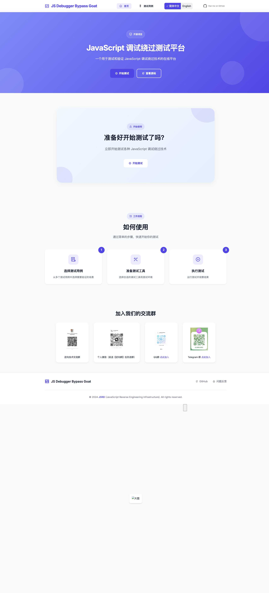
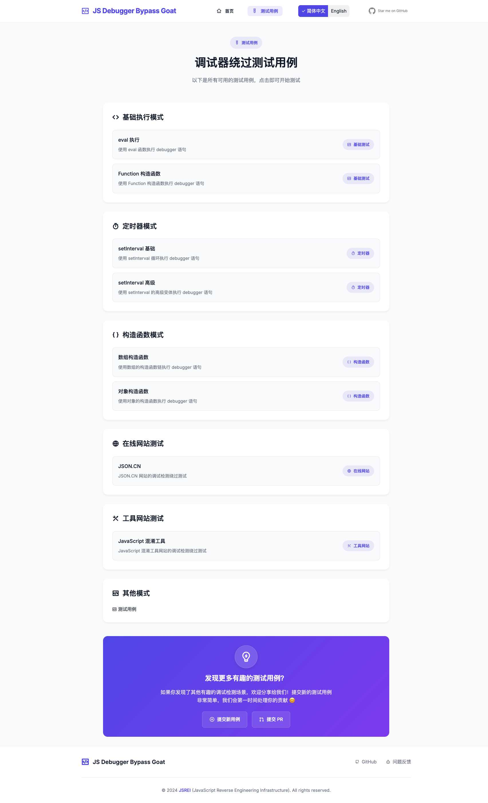
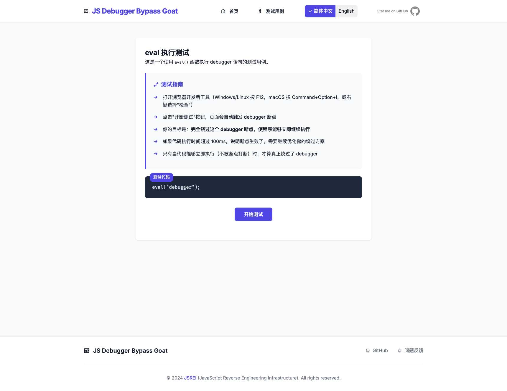

# JavaScript 调试绕过测试平台 (JS Debugger Bypass Goat)

<div align="center">

[](https://github.com/JSREI/js-debugger-bypass-goat/stargazers)
[](https://github.com/JSREI/js-debugger-bypass-goat/network/members)
[](https://github.com/JSREI/js-debugger-bypass-goat/issues)
[](https://github.com/JSREI/js-debugger-bypass-goat/blob/main/LICENSE)
[](https://jsrei.github.io/js-debugger-bypass-goat/)
[](https://github.com/JSREI/js-debugger-bypass-goat/pulls)
[](https://developer.mozilla.org/zh-CN/docs/Web/JavaScript)
[](https://developer.mozilla.org/zh-CN/docs/Web/HTML)
[](https://developer.mozilla.org/zh-CN/docs/Web/CSS)
[](https://github.com/JSREI/js-debugger-bypass-goat/commits)
[](https://github.com/JSREI/js-debugger-bypass-goat)
[](https://opensource.org/)
[](https://github.com/JSREI)

[中文(当前) | [English](README.en.md)]

</div>

## 📚 项目介绍

这是一个用于测试JavaScript反调试绕过技术的在线平台。该平台提供了多个测试案例，帮助开发者和安全研究人员测试和验证JavaScript调试器绕过工具的有效性。

## 🌐 在线体验

👉 **[https://jsrei.github.io/js-debugger-bypass-goat/](https://jsrei.github.io/js-debugger-bypass-goat/)**

## 📸 项目截图

### 首页界面


### 测试用例列表


### 具体测试用例示例


## ✨ 项目特点

- 🧪 **多样化的测试案例** - 覆盖从基础到高级的各种调试绕过场景
- ⚡ **实时验证功能** - 即时检查绕过技术的有效性
- 🏷️ **清晰的难度分级** - 按简单、中等、困难进行分类
- 📖 **详细的案例说明** - 每个测试用例都有详细文档
- 📋 **代码可复制功能** - 方便用户研究和使用测试代码
- 🌍 **多语言支持** - 支持中文和英文界面

## 🧪 测试用例

| 序号 | 测试用例 | 难度 | 描述 |
|------|---------|------|------|
| 1 | 基础 debugger 语句 | 简单 | 测试最基本的 JavaScript debugger 语句绕过能力 |
| 2 | 条件触发 debugger | 中等 | 测试在特定条件下触发的 debugger 语句绕过能力 |
| 3 | 混淆代码中的 debugger | 困难 | 测试在经过混淆处理的代码中识别和绕过 debugger 的能力 |
| 4 | 定时器 debugger | 中等 | 测试通过定时器延迟触发的 debugger 语句绕过能力 |
| 5 | 事件监听器 debugger | 困难 | 测试通过事件监听器触发的 debugger 语句绕过能力 |
| 6 | 代理对象 debugger | 困难 | 测试通过代理对象触发的 debugger 语句绕过能力 |

## 🚀 本地开发

1. 克隆仓库：
```bash
git clone https://github.com/JSREI/js-debugger-bypass-goat.git
```

2. 进入项目目录：
```bash
cd js-debugger-bypass-goat
```

3. 使用任意HTTP服务器运行项目，例如：
```bash
python -m http.server 8080
```

4. 在浏览器中访问：`http://localhost:8080`

## 🔗 相关项目

- [js-debugger-bypass](https://github.com/JSREI/js-debugger-bypass) - JavaScript调试器绕过工具

## 👥 交流群

欢迎加入我们的技术交流群：

- 微信群：扫描仓库首页提供的二维码，或添加个人微信并发送【逆向群】，我们会拉你进群
- QQ群：[点此加入](https://qm.qq.com/q/YfdB3w3OEY)
- Telegram群：[https://t.me/jsreijsrei](https://t.me/jsreijsrei)

## 🤝 贡献

欢迎提交Pull Request来添加新的测试用例或改进现有用例。任何形式的贡献都将被感激！

## 📜 许可证

[MIT License](LICENSE) - © JSREI (JavaScript Reverse Engineering Infrastructure) 

---

# 逆向技术交流群

<div align="center">
  <div style="margin-bottom: 20px;">
    <h3>扫码加入逆向技术微信交流群：</h3>
    <div style="background-color: #f8f9fa; padding: 15px; border-radius: 8px; display: inline-block;">
      
    </div>
  </div>

  <div style="margin-bottom: 20px;">
    <h3>如群二维码过期，可以加我个人微信，发送【逆向群】拉你进群：</h3>
    <div style="background-color: #f8f9fa; padding: 15px; border-radius: 8px; display: inline-block;">
      
    </div>
  </div>

  <div style="margin-bottom: 20px;">
    <h3><a href="https://qm.qq.com/q/YfdB3w3OEY">点此</a>扫码加入QQ交流群：</h3>
    <div style="background-color: #f8f9fa; padding: 15px; border-radius: 8px; display: inline-block;">
      
    </div>
  </div>

  <div style="margin-bottom: 20px;">
    <h3><a href="https://t.me/jsreijsrei">点此</a>或扫码加入TG交流群：</h3>
    <div style="background-color: #f8f9fa; padding: 15px; border-radius: 8px; display: inline-block;">
      
    </div>
  </div>
</div> 

## ⭐ Star History

[](https://star-history.com/#JSREI/js-debugger-bypass-goat&Date) 

## 项目结构

这个项目最近进行了重构，采用了现代的模块化架构：

```
js-debugger-bypass-goat/
├── js/                        # JavaScript源代码
│   ├── core/                  # 核心工具类
│   │   ├── constants.js       # 常量定义
│   │   ├── event-emitter.js   # 事件发布订阅
│   │   └── utils.js           # 通用工具函数
│   ├── i18n/                  # 国际化相关代码
│   │   ├── core/              # 国际化核心模块
│   │   │   ├── dom-handler.js # DOM处理
│   │   │   ├── i18n-manager.js# 国际化管理器
│   │   │   └── resource-loader.js # 资源加载器
│   │   ├── locales/           # 语言资源文件
│   │   │   ├── en-US.js       # 英文
│   │   │   └── zh-CN.js       # 中文
│   │   └── ui/                # 国际化UI组件
│   │       └── language-switcher.js # 语言切换器
│   ├── ui/                    # UI组件
│   │   ├── code-block.js      # 代码块组件
│   │   └── image-viewer.js    # 图片查看器
│   ├── app.js                 # 应用主逻辑
│   ├── compat.js              # 向下兼容层
│   └── main-new.js            # 新的入口点
├── styles/                    # CSS样式文件
├── cases/                     # 测试用例列表页
├── test-cases/                # 具体测试用例
│   ├── execute-debugger-patterns/  # 执行模式测试
│   ├── online-site/           # 在线网站测试
│   └── tools/                 # 工具网站测试
├── index.html                 # 首页
├── deploy.sh                  # 部署脚本
└── update-html-files.sh       # HTML文件更新脚本
```

## 国际化系统

我们实现了一个现代的国际化(i18n)系统，支持以下功能：

- 基于数据属性的声明式绑定 (`data-i18n`, `data-i18n-params`, `data-i18n-attr`)
- 动态语言切换和持久化
- 模块化设计，易于扩展
- 自动监听DOM变化，处理动态添加的内容
- 完整的向下兼容性支持，兼容旧版页面

## 开发指南

### 使用国际化

在HTML中添加国际化：

```html
<!-- 简单文本翻译 -->
<div data-i18n="common.hello"></div>

<!-- 带参数的翻译 -->
<div data-i18n="common.welcome" data-i18n-params='{"name": "User"}'></div>

<!-- 翻译属性 -->
<input data-i18n-attr="placeholder:common.searchPlaceholder" />
```

在JavaScript中使用翻译：

```javascript
// 使用全局翻译函数
const text = t('common.hello');

// 带参数
const welcome = t('common.welcome', {name: 'User'});

// 使用i18n对象
const text = i18n.translate('common.hello');
```

### 添加新的语言资源

在 `js/i18n/locales` 目录下创建新的语言文件。

### 部署

使用部署脚本构建项目：

```bash
./deploy.sh
```

构建后的文件将位于 `dist/` 目录。

## 浏览器兼容性

该项目兼容所有现代浏览器，包括：

- Chrome 60+
- Firefox 60+ 
- Safari 12+
- Edge 79+

## 贡献

欢迎提交PR和Issue，请保持代码风格一致。

## 许可证

MIT 